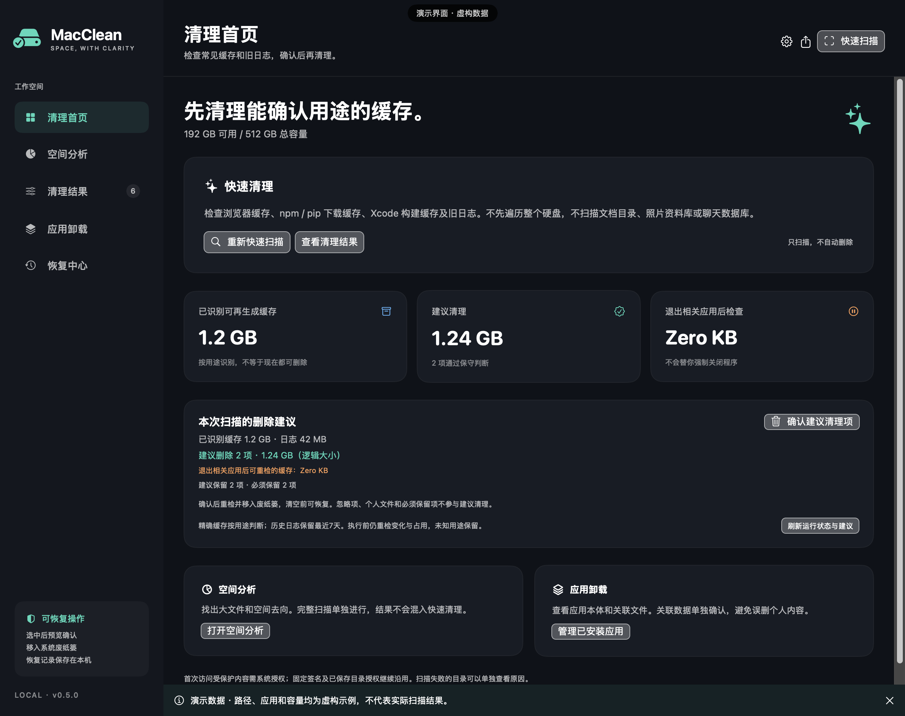

# MacClean

让每一 GB 都有来有去。

MacClean 是一个用 SwiftUI 构建的原生 macOS 空间分析与清理工具。它帮你看清文件、目录和应用的占用，给出清理候选及判断依据，再由你选择要处理的项目。

当前版本：**v0.5.0 · Apple Silicon 预览版**。提供源码、安装包及离线图文说明，尚未经过 Apple 公证。

v0.5 按精确用途判断浏览器、Codex/豆包网页缓存、macOS pip、npm 及 node-gyp 缓存，不再要求这些明确可再生成的子目录整整14天无写入。运行中的相关应用仍会拦截，执行前重检与占用检查仍保留。所有可识别日志都展示，用户日志默认保留最近7天，系统日志只读；Trae 更新安装包单独列出，需手动核对是否仍待安装。“已识别缓存”与“当前建议清理”“退出应用后检查”分别统计，不承诺识别容量都可立即删除。

v0.4 首页默认快速清理：定向检查常见缓存和日志，按应用归组，建议项默认勾选，确认后重检再移入废纸篓。全盘空间分析为独立入口、独立报告，不覆盖清理结果。浏览器只新增精确缓存子目录规则，不把整个用户配置目录当作垃圾；近期写入及运行状态保护仍保留。本版暂不清理微信聊天附件，也不自动清理密码、数据库或模型。

[下载 v0.5.0](https://github.com/daxiangnaoyang/MacClean/releases/tag/v0.5.0) · [安装说明](docs/INSTALL.md) · [完整图文说明](docs/GUIDE.md) · [隐私与清理边界](docs/PRIVACY.md) · [更新记录](CHANGELOG.md)

发行包为 **Apple Silicon（arm64）**，提供拖入 Applications 的 DMG 和应用 ZIP。本版使用 ad-hoc 签名，**未经过 Apple 公证**；Intel Mac 尚未提供安装包。

说明图使用原生界面和虚构演示数据，不包含真实用户名、扫描路径或已安装应用清单。

## 可以用它做什么

磁盘快满时，最难判断的往往是：哪个目录占了空间？这些文件是什么？删掉之后还能不能找回来？

MacClean 把这些问题放进五个页面：

| 页面 | 可以看到和操作的内容 |
| --- | --- |
| 总览 | 磁盘可用容量、已分析空间、缓存候选和目录分布 |
| 空间分析 | 逐层展开目录，查看文件数、逻辑大小与已分配空间；按类型跨目录筛选 |
| 规则扫描 | 判断建议删除、建议保留和必须保留；可逐项选择，也可一键清理建议项 |
| 应用卸载 | 查看应用包大小，选择应用本体和精确匹配的关联文件 |
| 恢复中心 | 查看逐项操作结果，将仍在系统废纸篓中的文件恢复到原位置 |

## 从源码运行

### 环境要求

- macOS 14 或更新版本，这是项目声明的最低部署目标。
- Swift 6 工具链，可通过包含该版本的 Xcode 或 Command Line Tools 提供。
- 当前已在一台 Apple Silicon Mac 上使用 Swift 6.4 构建；其他系统版本与 Intel Mac 尚未完成兼容性验证。

取得源码后，在项目根目录执行：

~~~bash
swift run
~~~

也可以构建成可双击启动的应用：

~~~bash
zsh build-app.sh
open MacClean.app
~~~

构建脚本会在项目根目录生成或更新 `MacClean.app`，包含应用图标，并执行本地 ad-hoc 签名验证。预编译版本见 Releases；目前没有经过公证的安装包。

如果桌面已经有同一 Bundle ID 的独立 `MacClean.app` 副本，构建脚本也会同步它；首次同步前会在 `.build/MacClean-desktop-before-update.zip` 中保留旧副本。不会替换不同标识的其他应用。

如果想放到桌面，可以在 Finder 中为 `MacClean.app` 创建替身，再将替身移到桌面。更新应用后，先完全退出旧进程，再重新打开。

## 扫描与判断

### 深入目录，也看清文件类型

扫描在后台递归进行，包含隐藏文件，扫描期间可以停止。目录大小由内部文件累加得到，支持逐层查看。

支持识别视频、图片、音频、文档、代码、日志、安装包、压缩包、数据库、本地模型和虚拟磁盘，并按类型汇总和筛选。识别依据是扩展名、macOS 文件类型以及部分已知路径，例如 Ollama 的无扩展名模型 blob；不进行文件内容解析。

默认范围包含完整当前用户主目录（含隐藏目录）、全局 Applications、Library、Users/Shared、usr、opt、private 和 System 中存在的目录。系统目录只读分析；其他用户的私有主目录不默认纳入。排除 System/Volumes 卷镜像避免重复统计，可在设置中增减目录。

- 递归深度：默认全部层级，也可选择 3、6、12 层。
- 条目上限：默认不限（0），也可主动选择 30 万、100 万或 200 万。
- 大文件阈值与陈旧下载天数：均可调整。
- 支持导出 JSON 扫描报告，保留结果、命中依据和访问错误。

自选条目限制仍会截断扫描；默认不限。访问错误、深度截断、条目截断、未下载云文件和主动排除分别说明。扫描范围和参数持久保存。大范围扫描可能耗时较长、占用更多内存，可随时停止。

500 GB 总容量包含可用空间，不等于应扫描出 500 GB 文件。文件逻辑大小无法与 APFS 快照、克隆、元数据等精确对账；系统受保护和未归属空间不能当作零占用或可清理空间。

目录可通过“授权主目录（记住）”或“添加目录”保存 security-scoped bookmark，重新启动时无界面恢复授权；失效时提示重新授权。完全磁盘访问必须由本人在系统设置中授予，应用不会绕过系统保护。

本机开发可在被 Git 忽略的 `.signing-identity` 中记录固定代码签名证书 SHA-1 指纹，或设置 `MACCLEAN_SIGN_IDENTITY`。构建会固定 Bundle ID 与证书要求，不默默更换证书。首次从 ad-hoc 换到固定签名后需要重新授权；跨更新系统权限保留仍需实机验收。公开打包默认 ad-hoc，不使用本机私人签名证书，也不因此获得 Apple 公证。

### 六类规则候选

| 类别 | 当前判断依据 |
| --- | --- |
| 应用缓存 | 用户 `Library/Caches` 下已完整扫描的直接子项目 |
| 开发缓存 | Xcode DerivedData、npm、pip 等已知缓存位置中的完整子项目 |
| 旧日志 | 用户日志目录中的日志文件，距最后修改至少 30 天 |
| 旧安装包 | 下载目录中的安装包，距最后修改至少 14 天 |
| 陈旧下载 | 下载目录中的文件，默认至少 90 天未修改 |
| 大文件 | 默认大小至少 100 MiB，可在设置中调整 |

每项结果会展示完整路径、类型、大小、修改时间及命中理由；内部保留可再生成、需确认、个人文件、受保护的分类，界面进一步给出下文的删除或保留建议。

### 建议删除还是保留

扫描完成后，会自动形成三类建议：

| 建议 | 判断与处理 |
| --- | --- |
| 建议删除 | 已完整扫描、归属明确、至少 14 天没有写入且相关程序未运行的已知可再生成缓存；或用户日志目录中至少 30 天未修改的旧日志 |
| 建议保留 | 个人文档、安装包、未知归属的缓存、近期写入的数据，以及扫描或运行状态不明确的项目 |
| 必须保留 | 系统位置、程序组件、依赖、配置、数据库、模型、虚拟磁盘及关键数据；正在使用的已知缓存也会临时拦截 |

已知缓存目前覆盖 npm、pip、Xcode DerivedData 和部分浏览器缓存。规则按用途、完整性、目录内最新写入与运行状态共同判断，不会仅凭文件夹日期或“可再生成”标签推荐删除。这是一套保守规则，无法证明所有文件都没有用途；未知情况默认保留。

每项可选择“按建议 / 保留 / 删除”。手动选择删除进入预览清理，不自动变成系统删除建议。标记保留会保存在本机，并在后续扫描中继续排除；取消标记可恢复按规则判断。必须保留的项目不能通过规则清理强行删除，应用本体和精确关联数据仍由单独的卸载入口处理。

总览和规则扫描中提供 **一键清理建议项**：点击后先重检内容变化和运行状态，再检查文件占用，最后移入废纸篓。发生变化、仍被程序打开或不能确认状态的项目会保留并记录结果。扫描完成不会自动执行删除；手动标记保留的文件、个人文件和手动选择删除项均不进入一键建议。

一键清理后需要重新扫描，更新占用和建议。若扫描主动停止或保留设置损坏，一键清理会停用；部分扫描中只有符合完整性条件的项目才可进入建议。

大文件、旧文件不会自动勾选。缓存也需要先确认用途，并退出相关应用。修改时间只说明文件什么时候发生了变化，不能证明它已经不再使用。

### 占用数字怎么理解

“逻辑大小”是文件内容大小，“已分配空间”是文件系统报告的分配大小。APFS 克隆、硬链接和快照等机制可能使统计值与真正可释放的容量不同。

重叠扫描根目录会去重；扫描不跟随符号链接，也会跳过已识别为未下载的云端文件。应用包内部只聚合大小，不提供逐个内部文件的清理入口。

因此，扫描候选的总大小不等于清理后一定增加的可用空间。执行操作后需要重新扫描，更新空间统计。

## 应用卸载

MacClean 从 `/Applications` 和用户的 `Applications` 目录中查找应用，并递归计算应用包大小。

选择应用后，会按 Bundle ID 精确匹配已知位置中的关联文件，包括缓存、日志、偏好设置、应用支持文件、保存状态、独立容器、HTTP 存储和 WebKit 数据。

关联文件默认不勾选，因为其中可能包含登录状态、设置和个人数据。应用用自定义名称存放的数据不保证能找到；共享组容器不参与自动匹配。

运行中的应用、Apple 应用、MacClean 自身以及无法确认 Bundle ID 的应用会被保护。卸载前可以逐项选择，并在确认面板核对完整路径。

## 清理与恢复

基本操作顺序是：

1. 扫描并查看命中依据。
2. 勾选项目，核对清理预览中的路径。
3. 确认移入系统废纸篓。
4. 在恢复中心查看逐项结果，必要时恢复原位。

执行前会记录操作意图；成功移入后保存系统返回的实际废纸篓路径。操作失败会单独记录，不会把失败项显示为清理成功。恢复遇到同名文件时会停止，不覆盖现有内容。

恢复依赖以下条件：文件仍在废纸篓中、原来的父目录仍存在，且原位置没有同名冲突。清空废纸篓或移走其中的文件后，就无法通过 MacClean 恢复。

历史记录保存在本机：

~~~text
~/Library/Application Support/MacClean/history.json
~~~

手动保留设置存放在同目录的 `keep.json`，只记录本机路径。读取失败时一键建议停用，不覆盖损坏的设置。

如果历史记录损坏，新的清理操作会停止，避免继续处理而丢失恢复信息。

## 保护范围与当前限制

当前处理范围是用户目录和允许卸载的非系统应用，不请求管理员权限。外置盘可以加入只读分析范围，当前不支持自动清理外置盘文件。

模型共享存储、iPhone 备份、Simulator 数据、照片资料库、Git 内部文件、Mail、Messages、Keychains 和共享组容器等位置受保护。模型、备份及环境数据适合通过所属工具管理；虚拟磁盘和数据库会提供用途提示，并列为必须保留，不能在规则清理中删除。

当前尚未实现：

- 按文件内容哈希查找重复文件。
- 系统快照清理和特权系统清理。
- 全面的应用残留识别、后台服务及登录项卸载。
- 自动更新和经过公证的发行版。

## 开发与验证

使用 Swift Package Manager 构建：

~~~bash
swift build -j 2
~~~

生成应用后，可运行内置验证及只读命令：

~~~bash
# 使用临时生成的文件，验证递归、规则、路径保护及实际废纸篓恢复
./MacClean.app/Contents/MacOS/MacClean --self-test

# 只读扫描指定目录，输出 JSON
./MacClean.app/Contents/MacOS/MacClean --scan-json "/path/to/folder"

# 只读获取应用列表及包大小，输出 JSON
./MacClean.app/Contents/MacOS/MacClean --apps-json
~~~

已验证深层与隐藏文件统计、扫描范围去重、符号链接循环、深度和数量限制、规则时间边界、Bundle ID 精确匹配、失败记录、原位恢复、同名冲突保护和扫描后文件修改检测。

v0.3 新增验证：三类建议、未知缓存保留、近期子文件识别、活跃工具及浏览器拦截、手动保留持久化、嵌套同大小文件变化拦截；使用临时文件实际执行一键清理，验证保留文件与手动个人文件不会被一键处理、打开的文件被拦截、清理结果可原位恢复，以及损坏设置停用。

曾进行本机只读扫描与应用包统计；具体用户目录、文件清单和报告不进入公开仓库。原生界面离屏渲染已检查，完整的窗口鼠标交互验收与跨版本兼容性仍待完善。公开验收范围见 [VERIFICATION.md](VERIFICATION.md)。

发布说明图可以用虚构数据重新生成，不会扫描真实文件或读取真实应用清单：

~~~bash
./MacClean.app/Contents/MacOS/MacClean --render-public-docs docs/images
~~~

发布包构建命令：`zsh package-release.sh`，需要系统 Swift 工具链与 Node.js（仅用于发布隐私检查，运行应用不需要 Node）。源码保留在仓库，安装包与 SHA-256 校验文件放在 GitHub Releases，不将本机 `.build` 或应用副本提交为源码。

## 反馈

欢迎通过仓库的 Issues 提交问题或建议。报告扫描问题时，附上版本、系统版本、扫描设置和错误提示，有助于复现。

截图和导出的 JSON 报告可能包含用户名、完整路径和文件名。分享前请检查，并移除不希望公开的信息。

## 许可证与参考

源码按 [MIT License](LICENSE) 发布。macOS、SwiftUI 等系统框架的权利归各自权利人；MIT 不代表 Apple 认证或公证。

行为设计参考了 [Pearcleaner](https://github.com/alienator88/Pearcleaner)；文件移入废纸篓和空间统计使用 macOS 原生 API。参考资料见 [Apple FileManager](https://developer.apple.com/documentation/foundation/filemanager) 和 [URLResourceValues](https://developer.apple.com/documentation/foundation/urlresourcevalues)。

缓存与持久数据的用途取舍参考 [Apple 文件系统使用说明](https://developer.apple.com/documentation/foundation/using-the-file-system-effectively)、[npm cache 文档](https://docs.npmjs.com/cli/v7/commands/npm-cache/) 和 [pip cache 文档](https://pip.pypa.io/en/stable/cli/pip_cache/)。14 天、30 天与进程检测是本项目的保守策略，不是这些文档给出的统一清理标准。
