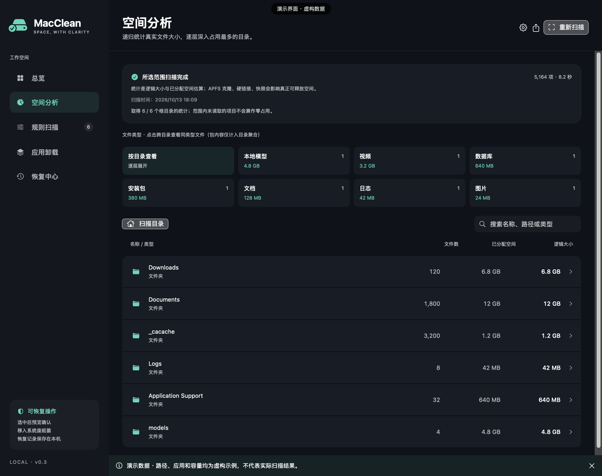
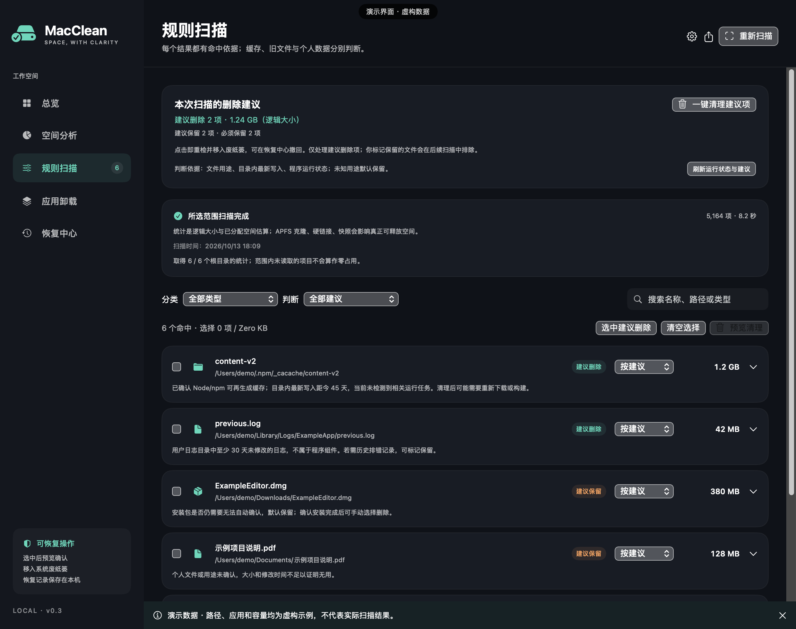
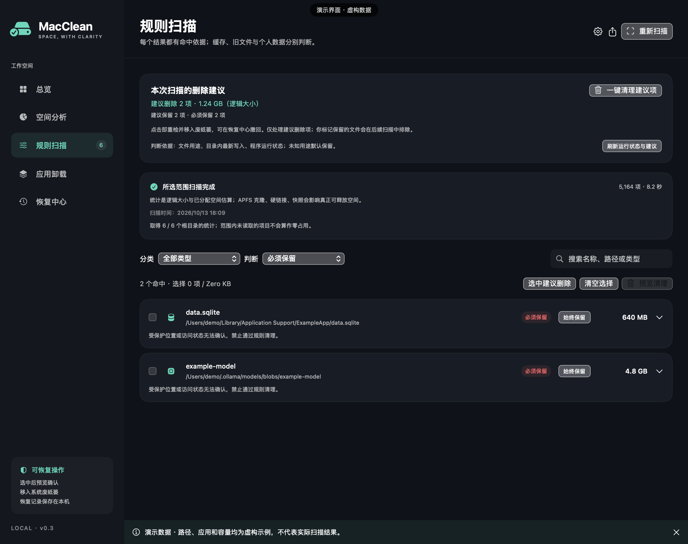
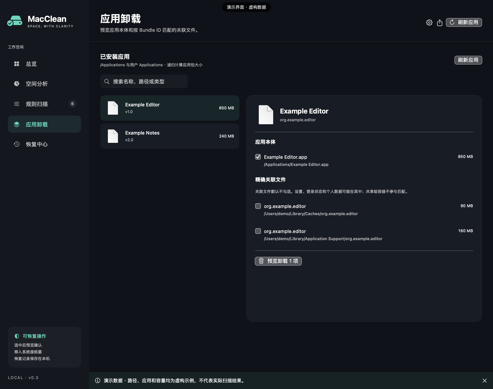
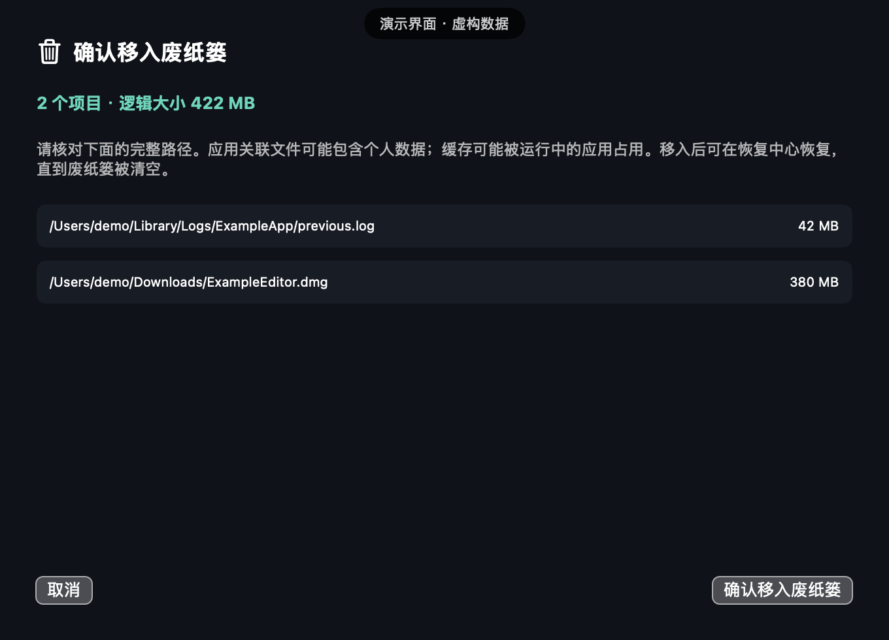
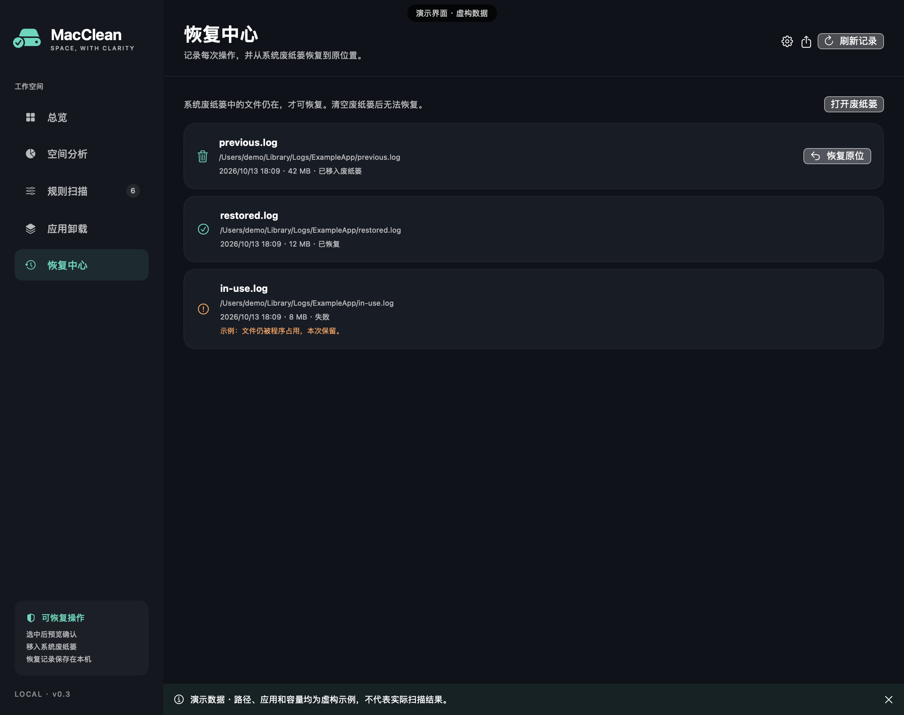
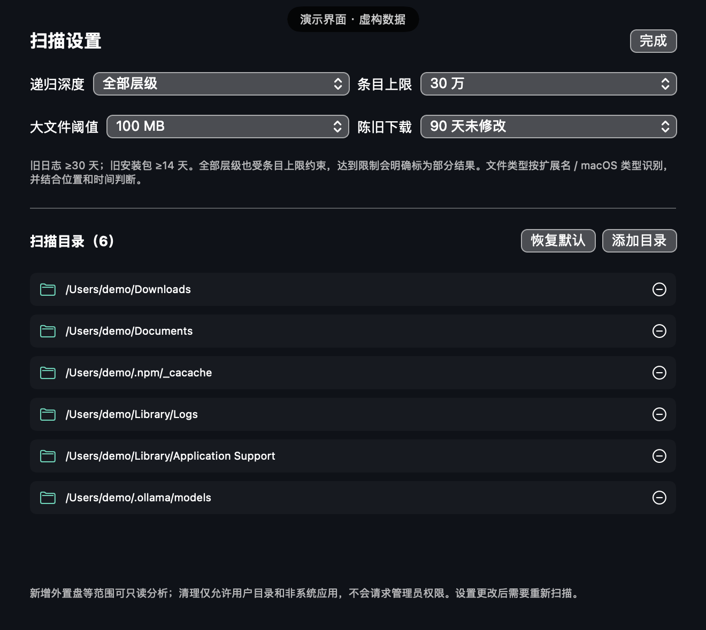

# MacClean 图文说明

所有图片均由本版原生 SwiftUI 界面生成，路径使用 `/Users/demo`，应用和占用数字是虚构示例；没有公开真实扫描记录。界面采用 macOS 系统字体。

## 1. 总览：先看空间去向

展示系统报告可用容量、已分析目录占用和推荐清理汇总。分析占用与真正可释放空间不是同一个数字；APFS 克隆、硬链接、快照和文件系统状态会影响结果。

## 2. 空间分析：逐层看目录和类型

目录大小来自递归聚合，不只看第一层。点击目录向下展开，也可以按视频、文档、代码、模型等类型跨目录筛选。应用包仅聚合大小，不提供内部组件删除入口。

## 3. 规则扫描：建议有依据，决定留给你

建议删除针对完整且归属明确的旧缓存、旧日志；未知用途和个人文件默认保留。可选择按建议、保留或删除；手动删除进入预览，不会扩大一键建议范围。

点击“一键清理建议项”会重检文件变化、运行状态及占用，再将通过检查的项目移入废纸篓。不会在扫描后自动执行；失败或状态不明确的项目本次保留。

## 4. 必须保留：不靠大小认定垃圾

系统位置、组件、程序持久数据、配置、模型、数据库、虚拟磁盘、资料库和运行中的已知缓存受到保护。运行中缓存的必留状态只针对当前检查；退出所属工具后可以重新扫描，不代表永远无法整理。

保守规则并非通用的“文件用途鉴定”。未识别的个人数据应保留并人工确认，不能因为文件很大或长期没修改就删除。

## 5. 应用卸载：本体与关联数据分别选

查找 Applications 中的应用并递归计量，用 Bundle ID 精确匹配关联文件，不模糊匹配相似名称。应用本体可选，关联文件默认不勾选，可能含设置、登录状态或个人数据。运行中、系统和身份未知的应用不能直接卸载。

## 6. 手动清理预览：完整路径可核对

普通手动清理和应用卸载先展示待处理路径，确认后移入废纸篓。本版不提供永久删除按钮。

## 7. 恢复中心：成功、失败、恢复分别记录

保存系统返回的实际废纸篓位置。文件仍在废纸篓、原父目录仍存在且没有同名冲突时，可恢复原位；恢复不会覆盖已有文件。废纸篓被清空后，记录不等于备份。

## 8. 扫描设置：范围与覆盖限制透明

默认递归全部层级，条目上限 30 万；可以调整为 3/6/12 层以及 100/200 万条目。目录访问失败、达到限制或用户停止时明确显示不完整结果。大文件阈值按 MiB 计算，界面沿用 MB 标签。

更多细节见 [README](../README.md)、[隐私与安全边界](PRIVACY.md) 和 [验收记录](../VERIFICATION.md)。
